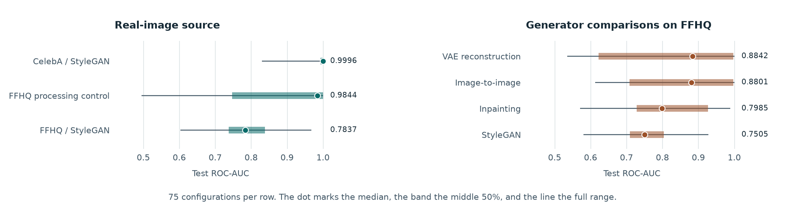

# Deepfake Source Bias

[Русский](README.md) · **English**

An evaluation of how image provenance and preprocessing affect face deepfake detectors. The benchmark compares **25 feature extractors paired with three classifiers** and includes separate experiments with CLIP, DINOv2, ResNet-50 and a ViT-Tiny hybrid.

[Dataset preparation](docs/datasets.en.md) · [Models and training](docs/models.en.md) · [Results](docs/results.en.md)



The **same StyleGAN test images** produced markedly different scores depending on the real comparison set. The median test ROC-AUC was **0.9996** against CelebA and **0.7837** against FFHQ. A control using only real FFHQ photographs, processed in two different ways, reached **0.9844**. Each row in the figure summarizes variation across detector configurations at seed 42.

## Quick start

Recalculate the summaries from the published per-configuration metrics. Python 3.10+ is sufficient. The command runs offline and uses the standard library.

```sh
git clone https://github.com/plisssa/deepfake-source-bias.git
cd deepfake-source-bias
python3 analysis/summarize.py --lang en
```

## Train a detector

Install the package from the checkout and prepare the FFHQ/StyleGAN corpus as described in the [dataset guide](docs/datasets.en.md). This example trains an XGBoost classifier on block-level RGB statistics for condition D.

```sh
python3.12 -m venv .venv
source .venv/bin/activate
python -m pip install -e .
python -m scripts.prepare_splits data=gan_only seed=42
python -m scripts.run_pipeline data=gan_only pipeline=col2 model=xgboost cv=holdout seed=42
```

For a local test using synthetic fixtures, install `pytest` and run `python -m pytest -q tests/test_pipelines_smoke.py`. To regenerate the figure, run `python analysis/plot_benchmark.py --lang en`.

## Neural baselines

The rows below come from completed cluster runs. The FFHQ/StyleGAN test has 6,000 images. The DeepFakeFace test has 5,967. The processing control measures discrimination between two preparations of the same real photographs.

| Model | FFHQ / StyleGAN AUC | DeepFakeFace AUC | Resize + JPEG control AUC |
| --- | ---: | ---: | ---: |
| Frozen CLIP ViT-L/14 + logistic regression | 0.9990 | 0.9998 | 0.9993 |
| Frozen DINOv2 ViT-B/14 + logistic regression | 0.9940 | 0.9564 | 0.8582 |
| Fine-tuned ResNet-50 | 0.99998 | 0.9999 | Unmeasured |

The [model catalog](docs/models.en.md) covers XGBoost heads, blur/JPEG augmentation and both ViT-Tiny preprocessing variants.

## Code and data

- [`deepfakes/`](deepfakes/) contains the feature extractors, estimators and evaluation routines. [`configs/`](configs/) holds the Hydra configurations.
- [`scripts/`](scripts/) contains the data preparation, training, control and transfer experiments. The [cluster environment](requirements-cluster.lock.txt) records the versions used for the reported results.
- [`results/`](results/) contains aggregate scores for each model or configuration. The [results guide](docs/results.en.md) maps the seven experimental conditions to the tables and explains their scope.

The software is distributed under the [MIT license](LICENSE). The [dataset guide](docs/datasets.en.md) links to the original image collections. To cite this software, use [CITATION.cff](CITATION.cff).
