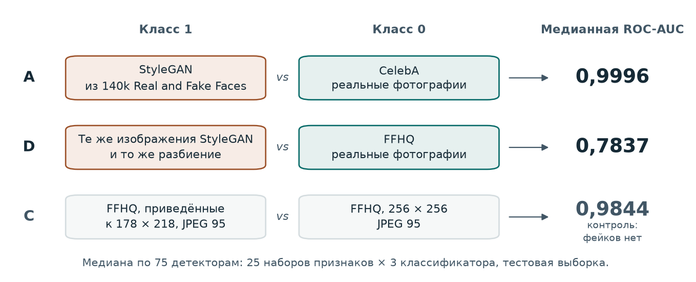
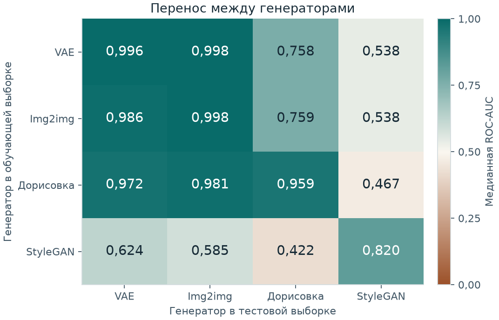

# Deepfake Source Bias

[](https://github.com/plisssa/deepfake-source-bias/actions/workflows/tests.yml)
[](pyproject.toml)
[](LICENSE)

**Русский** · [English](README.en.md)

Как меняется качество детектора дипфейков, если заменить источник реальных фотографий, а синтезированные лица оставить теми же? Исследование сравнивает 25 наборов признаков в сочетании с тремя классификаторами. Отдельные эксперименты проведены с CLIP, DINOv2, ResNet-50 и гибридной моделью на основе ViT-Tiny.

[Подготовка данных](docs/datasets.md) · [Модели и обучение](docs/models.md) · [Результаты по условиям A–G](docs/results.md)



**При сравнении одних и тех же изображений StyleGAN с фотографиями CelebA медианная ROC-AUC составила 0,9996, а с фотографиями FFHQ — 0,7837.** Две группы реальных фотографий FFHQ, обработанные разными способами, детекторы различили с медианной ROC-AUC 0,9844, хотя синтезированных изображений в этом опыте нет. Значит, высокий результат в условии A в значительной мере отражает различия в источнике и обработке реальных фотографий, а не признаки синтеза.


Каждая строка графика показывает разброс между 75 конфигурациями при фиксированном начальном значении генератора случайных чисел (42).

## Перенос между генераторами



В ячейке указана медианная тестовая ROC-AUC по десяти наборам признаков с XGBoost. После обучения на реконструкциях VAE медиана достигает 0,998 на img2img и 0,538 на StyleGAN. Строки обозначают генератор при обучении, столбцы — при тестировании.

Значения на диагонали выше медиан на предыдущем графике, потому что здесь учтены только десять наборов признаков с XGBoost. На предыдущем графике медиана рассчитана по всем 75 конфигурациям, включая логистическую регрессию и случайный лес.

[Графики контроля обработки и сравнения нейросетей](docs/results.md).

## Как проверить результаты

Команда пересчитывает показатели по опубликованным таблицам. После клонирования достаточно Python 3.10 или новее и его стандартной библиотеки.

```sh
git clone https://github.com/plisssa/deepfake-source-bias.git
cd deepfake-source-bias
python3 analysis/summarize.py
```

## Как обучить детектор

Подготовьте FFHQ и StyleGAN по [инструкции](docs/datasets.md). В примере ниже XGBoost обучается на статистиках каналов RGB, вычисленных по блокам изображения. Это условие D.

```sh
python3.12 -m venv .venv
source .venv/bin/activate
python -m pip install -e .
python -m scripts.prepare_splits data=gan_only seed=42
python -m scripts.run_pipeline data=gan_only pipeline=col2 model=xgboost cv=holdout seed=42
```

Тесты на синтетических изображениях запускаются командами `python -m pip install -e '.[dev]'` и `python -m pytest -q`. Графики строятся скриптами `analysis/plot_design.py`, `analysis/plot_benchmark.py` и `analysis/plot_experiments.py`.

## Нейросетевые модели

Результаты взяты из завершённых кластерных прогонов. Тестовая выборка FFHQ / StyleGAN содержит 6000 изображений, DeepFakeFace — 5967.

| Модель | ROC-AUC на FFHQ / StyleGAN | ROC-AUC на DeepFakeFace |
| --- | ---: | ---: |
| CLIP ViT-L/14 с фиксированными весами и логистической регрессией | 0,9990 | 0,9998 |
| DINOv2 ViT-B/14 с фиксированными весами и логистической регрессией | 0,9940 | 0,9564 |
| Дообученная ResNet-50 | > 0,9999 | 0,9999 |

В контроле обработки CLIP различает две версии одних и тех же реальных фотографий с ROC-AUC 0,9993, DINOv2 — 0,8582. В [каталоге моделей](docs/models.md) указаны также результаты с XGBoost, обучение с размытием и JPEG-сжатием и два варианта предобработки для ViT-Tiny.

## Состав репозитория

- [Код](deepfakes/) и [конфигурации](configs/) — извлечение признаков, классификаторы и расчёт метрик.
- [Скрипты](scripts/) — подготовка выборок, обучение, контрольные эксперименты и проверка переноса между генераторами. [Версии библиотек на кластере](requirements-cluster.lock.txt).
- [Таблицы результатов](results/) — сводные показатели для каждой конфигурации. [Описание таблиц](docs/results.md) связывает их с условиями эксперимента.
- [Анализ](analysis/) — пересчёт сводных показателей и построение графиков.

## Статья

Статья с результатами исследования находится на рецензировании. Ссылка на неё появится здесь после публикации.

## Цитирование

Сведения для цитирования приведены в [CITATION.cff](CITATION.cff). GitHub формирует по ним ссылку в меню «Cite this repository».

```bibtex
@software{puzyreva2026deepfakesourcebias,
  author  = {Puzyreva, Elizaveta},
  title   = {Deepfake Source Bias},
  year    = {2026},
  version = {1.0.0},
  url     = {https://github.com/plisssa/deepfake-source-bias}
}
```

Код распространяется по [лицензии MIT](LICENSE). Ссылки на исходные коллекции изображений приведены в [описании данных](docs/datasets.md).
