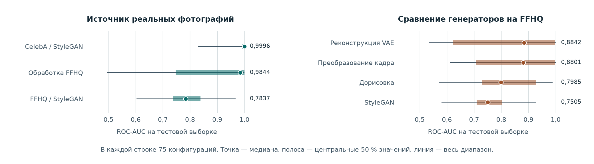

# Deepfake Source Bias

**Русский** · [English](README.en.md)

Как меняется качество детектора дипфейков, если заменить источник реальных фотографий, а синтезированные лица оставить теми же? Исследование сравнивает 25 наборов признаков в сочетании с тремя классификаторами. Отдельные эксперименты проведены с CLIP, DINOv2, ResNet-50 и гибридной моделью на основе ViT-Tiny.

[Подготовка данных](docs/datasets.md) · [Модели и обучение](docs/models.md) · [Результаты по условиям A–G](docs/results.md)



**При сравнении одних и тех же изображений StyleGAN с фотографиями CelebA медианная ROC-AUC составила 0,9996, а с фотографиями FFHQ — 0,7837.** Две группы реальных фотографий FFHQ, обработанные разными способами, детекторы различили с медианной ROC-AUC 0,9844. Каждая строка графика показывает разброс между 75 конфигурациями при фиксированном начальном значении генератора случайных чисел (42).

## Как проверить результаты

Команда пересчитывает показатели по опубликованным таблицам. После клонирования достаточно Python 3.10 или новее и его стандартной библиотеки.

```sh
git clone https://github.com/plisssa/deepfake-source-bias.git
cd deepfake-source-bias
python3 analysis/summarize.py
```

## Как обучить детектор

Подготовьте FFHQ и StyleGAN по [инструкции](docs/datasets.md). В примере ниже XGBoost обучается на статистиках каналов RGB, вычисленных по блокам изображения. Это условие D.

```sh
python3.12 -m venv .venv
source .venv/bin/activate
python -m pip install -e .
python -m scripts.prepare_splits data=gan_only seed=42
python -m scripts.run_pipeline data=gan_only pipeline=col2 model=xgboost cv=holdout seed=42
```

Для проверки на синтетических изображениях установите `pytest` и выполните `python -m pytest -q tests/test_pipelines_smoke.py`. Для повторного построения графика выполните `python analysis/plot_benchmark.py`.

## Нейросетевые модели

Результаты взяты из завершённых кластерных прогонов. Тестовая выборка FFHQ / StyleGAN содержит 6000 изображений, DeepFakeFace — 5967. Последний столбец показывает, насколько хорошо модель различает две версии одних и тех же реальных фотографий после изменения размера и сжатия JPEG.

| Модель | ROC-AUC на FFHQ / StyleGAN | ROC-AUC на DeepFakeFace | ROC-AUC в контроле обработки |
| --- | ---: | ---: | ---: |
| CLIP ViT-L/14 с фиксированными весами и логистической регрессией | 0,9990 | 0,9998 | 0,9993 |
| DINOv2 ViT-B/14 с фиксированными весами и логистической регрессией | 0,9940 | 0,9564 | 0,8582 |
| Дообученная ResNet-50 | 0,99998 | 0,9999 | Нет измерения |

В [каталоге моделей](docs/models.md) указаны также результаты с XGBoost, обучение с размытием и JPEG-сжатием и два варианта предобработки для ViT-Tiny.

## Состав репозитория

- [Код](deepfakes/) и [конфигурации](configs/) — извлечение признаков, классификаторы и расчёт метрик.
- [Скрипты](scripts/) — подготовка выборок, обучение, контрольные эксперименты и проверка переноса между генераторами. [Версии библиотек на кластере](requirements-cluster.lock.txt).
- [Таблицы результатов](results/) — сводные показатели для каждой конфигурации. [Описание таблиц](docs/results.md) связывает их с условиями эксперимента.

Код распространяется по [лицензии MIT](LICENSE). Ссылки на исходные коллекции изображений приведены в [описании данных](docs/datasets.md), сведения для цитирования — в [CITATION.cff](CITATION.cff).
