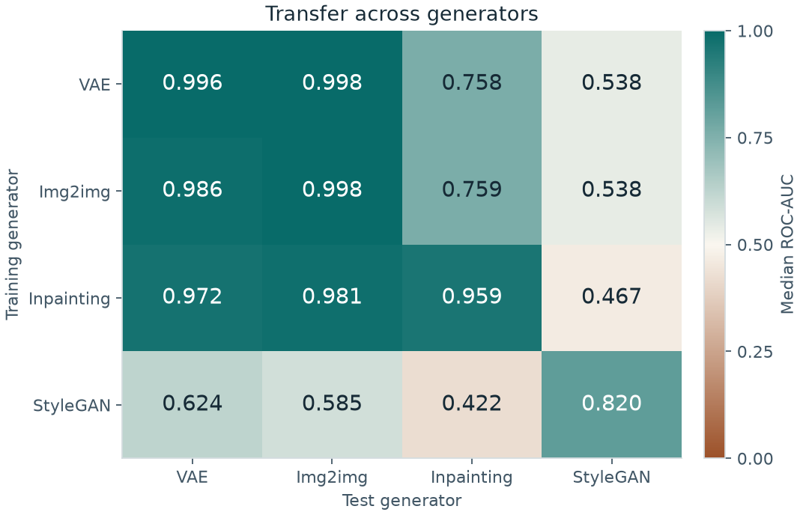
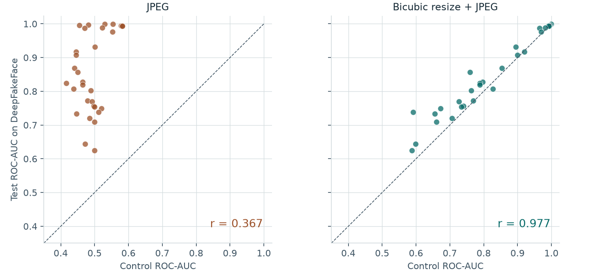
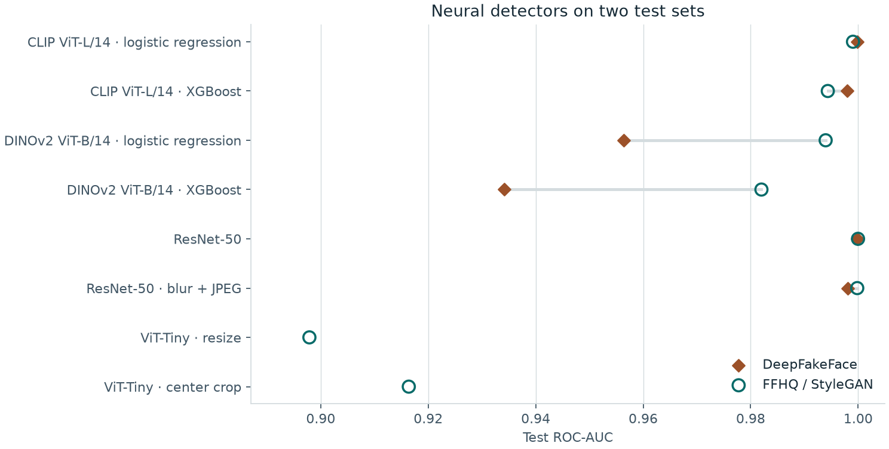

# Results by evaluation protocol

[Русский](results.md) · **English**

The comparison unit is one feature extractor and one classifier. Each primary grid has 25 × 3 distinct configurations at seed 42. The medians describe variation across those configurations.

| Condition | Comparison | Held-out result | Data |
| --- | --- | --- | --- |
| A | CelebA real vs. StyleGAN from 140k | Median AUC 0.9996 | [Feature benchmark](../results/feature-benchmark.csv) |
| B | Trivial classifiers on the files used in A | Geometry alone and file size alone both give AUC 1.000 | [File controls](../results/file-controls.csv) |
| C | Two disjoint groups of real FFHQ photographs with different geometry and matching JPEG quality | Median AUC 0.9844 | [Feature benchmark](../results/feature-benchmark.csv) |
| D | Real FFHQ vs. exactly the same StyleGAN examples and split as A | Median AUC 0.7837 | [Feature benchmark](../results/feature-benchmark.csv) |
| E | Real IMDB-WIKI vs. real FFHQ after common preprocessing | AUC 0.9842–0.9998 across nine feature sets | [Source control](../results/source-control.csv) |
| F | DeepFakeFace test vs. a processing-only comparison on real images | Pearson r = 0.9770 between test and bicubic resize + JPEG control AUC across 31 feature configurations with XGBoost | [Processing control](../results/processing-control.csv) |
| G | FFHQ originals and SD-derived images, with a separate StyleGAN comparison | Median AUC 0.8842 (VAE), 0.8801 (img2img), 0.7985 (inpaint), 0.7505 (StyleGAN) | [Feature benchmark](../results/feature-benchmark.csv), [transfer matrix](../results/generator-transfer.csv) |

## Transfer across generators

Each cell shows the median test ROC-AUC across ten feature sets with XGBoost. For models trained on VAE reconstructions, the median is 0.998 on img2img and 0.538 on StyleGAN. Rows indicate training, columns indicate testing. The diagonal is higher than the condition G medians in the table above because the matrix covers only the ten XGBoost feature sets, while the table uses all 75 configurations. [Source data](../results/generator-transfer.csv).

## Preprocessing on DeepFakeFace

Each point is one of 31 handcrafted feature sets with XGBoost. The same detectors are evaluated in both panels. The dashed line marks equal test and control ROC-AUC. The relationship is strongest when real photographs are resized before JPEG compression. [Source data](../results/processing-control.csv).

## Neural detectors on two test sets

Each row represents one model and training configuration. Circles mark FFHQ / StyleGAN (6,000 test images) and diamonds mark DeepFakeFace (5,967). Both ViT-Tiny variants were evaluated only on FFHQ / StyleGAN. [Source data](../results/neural-baselines.csv).

Regenerate these three figures with `python analysis/plot_experiments.py --lang en` using Matplotlib and NumPy.

## Reading the CSV files

- **Feature benchmark.** One row per condition, feature and classifier. The 600 rows cover eight primary grids: A, C, D, the DeepFakeFace test (tagged `F-test`) and the four G arms. The named conditions B and E are separate controls. The export retains only completed holdout measurements. Each score was checked against its source tracking record.
- **File controls.** Three negative-control runs. The shuffled-label column summarizes the recorded permutations for each feature and head.
- **Source control.** Test ROC-AUC for distinguishing two real image sources with nine XGBoost configurations. This measures source identifiability.
- **Processing control.** Test and control AUC for 31 handcrafted-feature configurations plus four frozen-backbone/head combinations. The control compares two versions of the same real photographs using recompression alone or resize followed by recompression.
- **Neural baselines.** Fourteen full holdout results with the logged backbone, head, seed and test count. [Model and training settings](models.en.md).
- **Generator transfer.** A four-by-four train/test generator matrix for each of ten feature pipelines using XGBoost. The diagonal gives within-generator results. The off-diagonal cells measure transfer to another generator on its test split. Scores in this export follow the four-decimal precision of the evaluation output.

The CSV fields identify the feature set (`feature`), classifier (`classifier`), neural encoder (`backbone`), and classification head (`head`). The fields `seed`, `n_test`, and `roc_auc` record the random seed, number of test images, and area under the ROC curve.

Run `python3 analysis/summarize.py --lang en` to recompute the condition summaries. Run `python analysis/plot_benchmark.py --lang en` with Matplotlib and NumPy installed to regenerate the overview. Tests and controls use the versions and group definitions in the [dataset guide](datasets.en.md).
