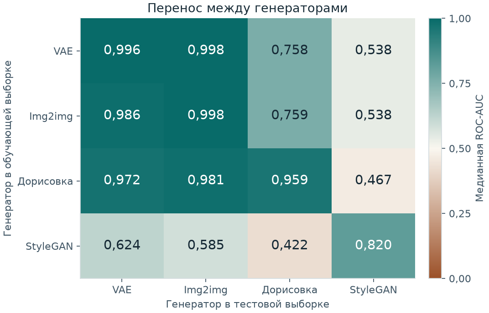
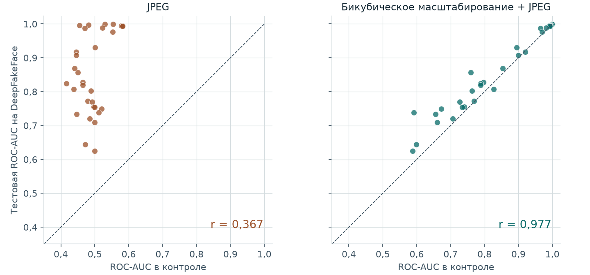
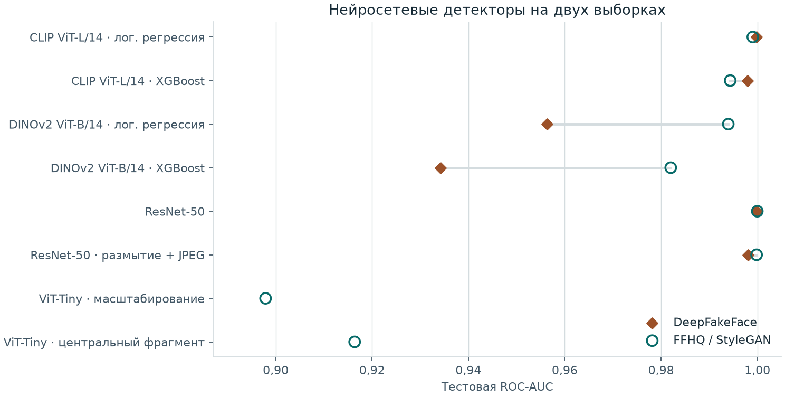

# Результаты по условиям A–G

**Русский** · [English](results.en.md)

Единица сравнения — сочетание одного способа извлечения признаков и одного классификатора. В основной матрице 25 × 3 конфигурации. Медиана описывает результат по этим 75 конфигурациям при одном фиксированном начальном значении генератора случайных чисел (42).

| Условие | Что сравнивается | Результат на тестовой выборке |
| --- | --- | --- |
| A | Реальные CelebA и изображения StyleGAN из 140k | Медианная ROC-AUC 0,9996 |
| B | Признаки файлов из условия A | Размер кадра и объём файла по отдельности дают ROC-AUC 1,000 |
| C | Две непересекающиеся группы реальных FFHQ с разной геометрией при одинаковом качестве JPEG | Медианная ROC-AUC 0,9844 |
| D | Реальные FFHQ и те же изображения StyleGAN с тем же разбиением, что в A | Медианная ROC-AUC 0,7837 |
| E | Реальные IMDB-WIKI и FFHQ после одинаковой обработки | ROC-AUC от 0,9842 до 0,9998 по девяти наборам признаков |
| F | Тест DeepFakeFace и контроль с изменением размера и JPEG-сжатием реальных фотографий | Корреляция Пирсона между тестовой и контрольной ROC-AUC равна 0,9770 по 31 конфигурации с XGBoost |
| G | Исходные FFHQ, три варианта Stable Diffusion и отдельная группа StyleGAN | Медианная ROC-AUC равна 0,8842 для реконструкции, 0,8801 для преобразования кадра, 0,7985 для дорисовки и 0,7505 для StyleGAN |

## Перенос между генераторами

В ячейке указана медианная тестовая ROC-AUC по десяти наборам признаков с XGBoost. После обучения на реконструкциях VAE медиана достигает 0,998 на img2img и 0,538 на StyleGAN. Строки обозначают генератор при обучении, столбцы — при тестировании. [Исходные значения](../results/generator-transfer.csv).

## Влияние обработки на DeepFakeFace

Каждая точка — один из 31 набора признаков с XGBoost. В обеих панелях показаны одни и те же детекторы. На пунктирной линии тестовая и контрольная ROC-AUC равны. Связь сильнее, когда реальные фотографии перед JPEG-сжатием дополнительно масштабируют. [Исходные значения](../results/processing-control.csv).

## Нейросетевые детекторы на двух выборках

В каждой строке показана одна конфигурация обучения. Круги обозначают FFHQ / StyleGAN (6000 тестовых изображений), ромбы — DeepFakeFace (5967). Для двух вариантов ViT-Tiny есть измерения только на FFHQ / StyleGAN. [Исходные значения](../results/neural-baselines.csv).

Для построения этих трёх графиков выполните `python analysis/plot_experiments.py` с установленными Matplotlib и NumPy.

## Как читать таблицы

| Таблица | Что означает строка |
| --- | --- |
| [Основная матрица](../results/feature-benchmark.csv) | Одна конфигурация в одном условии. Всего 600 строк в восьми матрицах — A, C, D, тест DeepFakeFace (`F-test`) и четыре варианта G. Каждая оценка сверена с записью завершённого прогона |
| [Контроли по файлам](../results/file-controls.csv) | Один из трёх контрольных прогонов. Приведены оценки по геометрии, объёму файла и при перестановке меток |
| [Контроль источника](../results/source-control.csv) | Тестовая ROC-AUC при классификации реальных фотографий по источнику. Рассмотрены девять наборов признаков с XGBoost |
| [Контроль обработки](../results/processing-control.csv) | Сопоставление тестовой ROC-AUC с результатом на двух версиях одних и тех же фотографий. В таблице 31 конфигурация с явно заданными признаками и четыре сочетания нейросетевого кодировщика и классификатора. Отдельно показаны повторное сжатие и изменение размера со сжатием |
| [Нейросетевые модели](../results/neural-baselines.csv) | Один из 14 полных экспериментов. Указаны модель, классификатор или способ дообучения, начальное значение генератора случайных чисел и размер тестовой выборки |
| [Перенос между генераторами](../results/generator-transfer.csv) | Один из 16 вариантов сочетания обучающего и тестового генераторов для каждого из десяти наборов признаков с XGBoost. Диагональ соответствует проверке на том же генераторе, остальные ячейки показывают перенос. Значения сохранены до четырёх знаков после запятой |

В CSV поля `feature` и `classifier` обозначают набор признаков и классификатор. Для нейросетевых моделей `backbone` указывает кодировщик, `head` — способ классификации. Поле `seed` задаёт начальное значение генератора случайных чисел, `n_test` — число тестовых изображений, `roc_auc` — площадь под ROC-кривой.

Сводные показатели пересчитывает команда `python3 analysis/summarize.py`. Для повторного построения графика выполните `python analysis/plot_benchmark.py` с установленными Matplotlib и NumPy. [Версии данных и правила разбиения](datasets.md).
